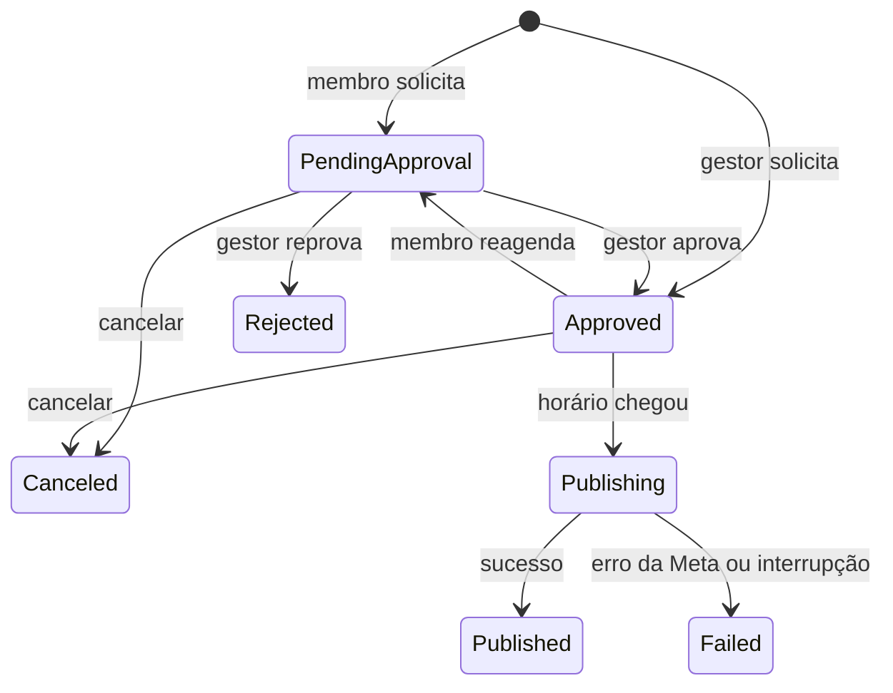

# Sienna — Guia de uso da API

Este guia mostra, passo a passo, como configurar o Sienna e usar todas as funcionalidades disponíveis: contas, times, convites, conexão com o Instagram, campanhas, postagens, publicação (imediata ou agendada), aprovação e acompanhamento.

> A documentação interativa de cada endpoint (campos, tipos e respostas) está no **Scalar**, em `/scalar`. Este guia explica **como as funcionalidades se encaixam** e em que ordem usá-las.

---

## Sumário

1. [Visão geral](#1-visão-geral)
2. [Configuração e execução](#2-configuração-e-execução)
3. [Conceitos gerais da API](#3-conceitos-gerais-da-api)
4. [Conta de usuário](#4-conta-de-usuário)
5. [Times e convites](#5-times-e-convites)
6. [Conexão com o Instagram](#6-conexão-com-o-instagram)
7. [Campanhas, postagens e imagens](#7-campanhas-postagens-e-imagens)
8. [Publicação no Instagram](#8-publicação-no-instagram)
9. [Aprovação, cancelamento e reagendamento](#9-aprovação-cancelamento-e-reagendamento)
10. [Acompanhamento das publicações](#10-acompanhamento-das-publicações)
11. [E-mails automáticos](#11-e-mails-automáticos)
12. [Métricas das publicações](#12-métricas-das-publicações)
13. [Referência rápida de endpoints](#13-referência-rápida-de-endpoints)
14. [Solução de problemas](#14-solução-de-problemas)
15. [Limitações conhecidas](#15-limitações-conhecidas)

---

## 1. Visão geral

O fluxo completo, do cadastro até a publicação no Instagram:

```
Cadastro e login
   └─ Criar um time (quem cria é o dono)
        ├─ Convidar pessoas (elas aceitam pelo próprio usuário)
        ├─ Conectar a conta do Instagram do time
        └─ Criar uma campanha
             └─ Cadastrar uma postagem → enviar as imagens → associar à campanha
                  └─ Solicitar a publicação (agora ou agendada)
                       ├─ Pedido de membro → aguarda aprovação de um dono/administrador
                       └─ Aprovada → o serviço em background publica no horário
```

### Papéis no time

| Papel | Valor na API | Pode |
|---|---|---|
| Dono | `owner` | Tudo o que o administrador pode. É quem criou o time |
| Administrador | `administrator` | Convidar pessoas, conectar o Instagram, aprovar/reprovar publicações, cancelar ou reagendar qualquer publicação |
| Membro | `member` | Ver o time, criar campanhas, solicitar publicações das próprias postagens (que passam por aprovação), cancelar ou reagendar as próprias solicitações |

Neste guia, **gestor** significa dono ou administrador.

---

## 2. Configuração e execução

### 2.1 Pré-requisitos

- .NET 10 SDK
- PostgreSQL (local ou o banco do Render)
- Uma conta no Resend com o domínio de envio verificado (para os e-mails)
- Para publicar no Instagram: um app no Meta for Developers e uma conta do Instagram **Business** ou **Creator** (ver a [seção 6](#6-conexão-com-o-instagram))

### 2.2 Configuração

Em desenvolvimento, a configuração fica no `Sienna.WebApi/appsettings.Development.json` (que **não** vai para o repositório). Em produção, use variáveis de ambiente, trocando `:` por `__` (ex.: `SecretProviderSettings__Key`).

| Seção / variável | Obrigatória | Para quê |
|---|---|---|
| `DATABASE_URL` (variável de ambiente) ou `ConnectionStrings:DATABASE_URL` | Sim | Conexão com o PostgreSQL |
| `Jwt:Issuer`, `Jwt:Audience`, `Jwt:Key` | Sim | Geração e validação dos tokens de login |
| `ResendSettings:ApiKey`, `SenderAddress`, `SenderName` | Sim | Envio de e-mails |
| `SecretProviderSettings:Key` | Sim | Chave que cifra os tokens do Instagram no banco |
| `InstagramSettings:GraphBaseUrl` | Sim | Endereço da API da Meta: `https://graph.instagram.com/v23.0/` (com a barra no final) |
| `InstagramSettings:PublicMediaBaseUrl` | Sim | URL pública de onde a Meta baixa as imagens: `https://<sua-api>/api/media/public/` |
| `PublicationWorkerSettings` | Não | Intervalo (padrão 30 s) e lote (padrão 10) do serviço de publicação |
| `InsightsWorkerSettings` | Não | Intervalo (padrão 5 min), lote (padrão 20) e pausa após falha (padrão 60 min) da coleta de métricas |

Sem as configurações obrigatórias, a API **não inicia** e informa qual está faltando.

**Gerando a chave de criptografia** (32 bytes em Base64):

```bash
openssl rand -base64 32
```

> Guarde a chave num local seguro. Se ela for trocada, os tokens do Instagram já salvos deixam de poder ser lidos e cada time precisa reconectar a conta.

### 2.3 Executando

```bash
dotnet run --project Sienna.WebApi
```

- Em **Debug**, as migrations do banco são aplicadas automaticamente na inicialização.
- A documentação interativa fica em `https://localhost:7183/scalar` (ou `http://localhost:5255/scalar`).
- Para gerar uma nova migration (com a API parada):

```bash
dotnet ef migrations add NomeDaMigration --project Sienna.Infrastructure --startup-project Sienna.WebApi
```

### 2.4 URL pública das imagens

Para publicar, a **Meta baixa as imagens pela internet**, usando o `PublicMediaBaseUrl`. Por isso:

- Rodando **localmente**, a Meta não acessa `localhost`. Use a API publicada (Render) ou um túnel:

  ```bash
  cloudflared tunnel --url http://localhost:5255
  ```

  e coloque a URL gerada no `PublicMediaBaseUrl`.
- A imagem precisa estar no **mesmo banco** que a API pública consulta.
- Confira sempre abrindo `https://<sua-api>/api/media/public/{id-da-mídia}` numa aba anônima: a imagem deve aparecer no navegador.

---

## 3. Conceitos gerais da API

### 3.1 Autenticação

1. Faça login (`POST /api/identity/tokens/login`) e copie o `token` da resposta.
2. Envie-o em todas as rotas protegidas no cabeçalho:

   ```
   Authorization: Bearer {token}
   ```

3. O token vale **30 minutos**. Depois disso, as rotas respondem `401` e é preciso fazer login de novo.

No Scalar, use o botão de autenticação e cole o token. As rotas com cadeado exigem autenticação.

### 3.2 Erros

Todas as falhas seguem o formato **Problem Details**:

```json
{
  "type": "Publication.AlreadyRequested",
  "title": "A domain error ocurred.",
  "status": 409,
  "detail": "Esta postagem já possui uma publicação pendente, agendada ou publicada neste formato."
}
```

- `type` é o **código do erro**, estável, para o front decidir o que fazer.
- `detail` é a **mensagem** para mostrar ao usuário.

| Status | Significado |
|---|---|
| `400` | Dados inválidos (campo vazio, formato errado, regra de negócio) |
| `401` | Não autenticado ou token expirado |
| `403` | Autenticado, mas sem permissão (não é membro do time, não é gestor...) |
| `404` | Não encontrado — também usado para recursos de outros times, para não revelar que existem |
| `409` | Conflito com o estado atual (já existe, já foi aprovado, foi alterado por outra operação...) |
| `429` | Limite de requisições atingido (ver [3.6](#36-limites-de-requisições)) |
| `502` | Falha de comunicação com a Meta |

### 3.3 Datas

- Todas as datas **retornadas** estão em **UTC** (terminam com `Z`), ex.: `2026-10-13T12:45:00Z`.
- Ao **enviar** um horário, informe sempre o **fuso**:

  ```
  2026-10-13T09:45:00-03:00     (09:45 em Brasília)
  2026-10-13T12:45:00Z          (o mesmo instante em UTC)
  ```

  Sem o fuso, o horário seria interpretado no fuso do servidor (UTC no Render), três horas adiantado.

### 3.4 Valores fixos (enums)

Valores como formato, status e papel trafegam como **texto em camelCase**:

| Campo | Valores |
|---|---|
| Formato da publicação | `feed`, `story` |
| Status da publicação | `pendingApproval`, `approved`, `rejected`, `canceled`, `publishing`, `published`, `failed` |
| Papel no time | `owner`, `administrator`, `member` |
| Ordem | `ascending`, `descending` |

No corpo JSON e na query string, maiúsculas e minúsculas são indiferentes (`feed`, `Feed` e `FEED` funcionam). Números (`0`, `1`) não são aceitos.

### 3.5 Paginação

As listagens paginadas aceitam `?page=` (a partir de 1, padrão 1) e `?pageSize=` (de 1 a 100, padrão 20) e respondem:

```json
{
  "items": [ ... ],
  "page": 1,
  "pageSize": 20,
  "totalCount": 47,
  "totalPages": 3,
  "hasNextPage": true,
  "hasPreviousPage": false
}
```

### 3.6 Limites de requisições

| Operação | Limite |
|---|---|
| Cadastro, login e "esqueci minha senha" | 10 por minuto, por IP |
| Convites para times | 20 por hora, por usuário |

Ao atingir o limite, a API responde `429` com o cabeçalho `Retry-After` (em segundos).

---

## 4. Conta de usuário

### 4.1 Cadastrar

```http
POST /api/identity/users
```

```json
{
  "email": "ana@empresa.com",
  "password": "Senha@123",
  "fullName": "Ana Souza"
}
```

- A senha precisa ter **no mínimo 6 caracteres**, com letra maiúscula, letra minúscula, número e símbolo.
- O e-mail é o login e precisa ser único (`409` se já existir).
- Responde `201` com o ID do usuário e envia um e-mail de boas-vindas.

### 4.2 Entrar (login)

```http
POST /api/identity/tokens/login
```

```json
{
  "email": "ana@empresa.com",
  "password": "Senha@123"
}
```

Resposta:

```json
{ "token": "eyJhbGciOi..." }
```

Após **5 tentativas erradas**, a conta é bloqueada por **5 minutos**.

### 4.3 Consultar os próprios dados

| Rota | Retorna |
|---|---|
| `GET /api/identity/users/me` | Perfil (ID, nome e e-mail) |
| `GET /api/identity/users/me/teams` | Times dos quais o usuário participa e o papel em cada um |
| `GET /api/identity/users/me/posts?page=1&pageSize=20` | Postagens criadas pelo usuário, com as imagens (paginado) |
| `GET /api/identity/users/me/invitations` | Convites pendentes para o e-mail do usuário (ver [5.3](#53-responder-a-um-convite)) |

### 4.4 Redefinir a senha

1. Solicite o token de redefinição:

   ```http
   POST /api/identity/tokens/reset-password
   ```

   ```json
   { "email": "ana@empresa.com" }
   ```

   O token chega por e-mail.

2. Defina a nova senha com o token recebido:

   ```http
   POST /api/identity/users/reset-password/confirm
   ```

   ```json
   {
     "email": "ana@empresa.com",
     "token": "token-recebido-por-email",
     "newPassword": "NovaSenha@456"
   }
   ```

---

## 5. Times e convites

### 5.1 Criar um time

```http
POST /api/workflow/teams
```

```json
{ "teamName": "Marketing Quavidog" }
```

Responde `201` com o ID do time. **Quem cria é o dono** do time.

### 5.2 Convidar pessoas

Ninguém é adicionado a um time diretamente: o gestor **convida pelo e-mail**, e a pessoa **aceita**.

```http
POST /api/workflow/teams/{teamId}/invitations
```

```json
{
  "email": "bruno@empresa.com",
  "role": "member"
}
```

- `role`: `member` ou `administrator`.
- Só **gestores** podem convidar.
- A resposta é sempre `202`, **exista ou não** uma conta com esse e-mail — a API não revela quem está cadastrado.
- O convidado recebe um e-mail. Se ainda não tiver conta, basta se cadastrar **com o mesmo e-mail** para ver o convite.
- O convite vale **7 dias**. Convidar de novo o mesmo e-mail **renova** o convite.
- `409` se o e-mail já pertence a um membro do time.
- Limite de **20 convites por hora** por usuário.

**Gerenciar os convites do time (gestores):**

| Ação | Rota |
|---|---|
| Listar os pendentes | `GET /api/workflow/teams/{teamId}/invitations` |
| Cancelar um convite | `DELETE /api/workflow/teams/{teamId}/invitations/{invitationId}` |

### 5.3 Responder a um convite

O convidado, **logado com o e-mail do convite**:

1. Lista os convites:

   ```http
   GET /api/identity/users/me/invitations
   ```

2. Aceita ou recusa:

   ```http
   POST /api/identity/users/me/invitations/{invitationId}/accept
   POST /api/identity/users/me/invitations/{invitationId}/decline
   ```

Ao aceitar, a pessoa entra no time com o papel do convite, e a resposta traz o ID do time. Respostas possíveis:

| Situação | Resposta |
|---|---|
| Convite para outro e-mail | `404` |
| Convite expirado | `409` `Invitation.Expired` |
| Já respondido ou cancelado | `409` `Invitation.InvalidStatus` |
| Já é membro do time | `409` `Invitation.AlreadyMember` |

### 5.4 Listar os membros

```http
GET /api/workflow/teams/{teamId}/members
```

Qualquer membro pode consultar. A lista vem ordenada por papel (dono, administradores, membros) e depois por nome.

---

## 6. Conexão com o Instagram

Cada time conecta **uma** conta do Instagram, pela qual as publicações são feitas.

### 6.1 Preparação na Meta (uma vez)

1. A conta do Instagram precisa ser **Business** ou **Creator** (no app: *Configurações → Tipo de conta e ferramentas → Mudar para conta profissional*).
2. No [Meta for Developers](https://developers.facebook.com/), crie um app com o caso de uso de **API do Instagram com login do Instagram**.
3. Em **Funções do app**, adicione a conta como **Testador do Instagram** e aceite o convite em *instagram.com → Configurações → Apps e sites → Convites de testador*. (Enquanto o app estiver em modo de desenvolvimento, só contas com função no app funcionam.)
4. Em **Gerar tokens de acesso**, adicione a conta e gere o token, autorizando as permissões de **publicação de conteúdo** e de **insights** (`instagram_business_content_publish` e `instagram_business_manage_insights`).
5. Copie o token. Ele vale cerca de **60 dias**.

### 6.2 Conectar ao time (gestores)

```http
PUT /api/teams/{teamId}/social/instagram
```

```json
{ "accessToken": "IGAA..." }
```

A API valida o token na Meta, descobre a conta automaticamente e guarda o token **cifrado**. Resposta:

```json
{
  "instagramUserId": "17841400000000000",
  "username": "quavidog",
  "connectedAt": "2026-10-12T14:00:00Z",
  "updatedAt": "2026-10-12T14:00:00Z"
}
```

Para trocar o token (por exemplo, quando expirar), basta chamar o `PUT` de novo.

| Erro | Causa |
|---|---|
| `400` `Instagram.InvalidToken` | Token recusado pela Meta (expirado, incompleto ou revogado) |
| `400` `Instagram.NotProfessional` | A conta não é Business nem Creator |
| `502` | Não foi possível falar com a Meta; tente de novo |

### 6.3 Consultar e desconectar

| Ação | Rota | Quem |
|---|---|---|
| Ver se há conta conectada | `GET /api/teams/{teamId}/social/instagram` | Qualquer membro |
| Desconectar (apaga o token) | `DELETE /api/teams/{teamId}/social/instagram` | Gestores |

A consulta responde `{ "isConfigured": false, "account": null }` quando não há conta conectada. **O token nunca é retornado pela API.**

---

## 7. Campanhas, postagens e imagens

### 7.1 Criar uma campanha

```http
POST /api/workflow/teams/{teamId}/campaigns
```

```json
{ "campaignName": "Promoção de outubro" }
```

Qualquer membro do time pode criar. Para listar: `GET /api/workflow/teams/{teamId}/campaigns`.

### 7.2 Cadastrar uma postagem

```http
POST /api/media/posts
```

```json
{ "caption": "Outubro chegou com descontos! 🐶 #quavidog" }
```

Responde `201` com o ID da postagem. **Limites do Instagram para a legenda:** 2.200 caracteres, 30 hashtags e 20 menções.

### 7.3 Adicionar as imagens

Cada imagem é enviada como **`multipart/form-data`**:

```http
POST /api/media/posts/{postId}/assets
Content-Type: multipart/form-data

file          = foto1.jpg
sequenceOrder = 1
```

- Só o **autor** da postagem pode adicionar imagens.
- Formato: **JPEG** (`.jpg` ou `.jpeg`), até **8 MB**.
- `sequenceOrder` define a **ordem** (1 = primeira) no carrossel ou na sequência de stories. Não pode haver duas imagens na mesma posição (`409`).
- Responde `201` com o ID da mídia.

**Proporção das imagens (exigência do Instagram):**

| Formato | Proporção aceita (largura ÷ altura) | Sugestão |
|---|---|---|
| Feed (imagem ou carrossel) | de **0,8** (4:5) a **1,91** (1,91:1) | 1080 × 1350 (4:5) ou 1080 × 1080 (1:1) |
| Story | qualquer, ideal **9:16** | 1080 × 1920 |

Fotos de celular "em pé" (3:4 ou 9:16) **não são aceitas no feed**. No carrossel, todas as imagens aparecem com a proporção da primeira, então use a mesma em todas. Imagens com menos de 320 px de largura são ampliadas e ficam borradas.

**Exemplo no front (JavaScript):**

```javascript
const form = new FormData();
form.append('file', arquivo);          // File de um <input type="file">
form.append('sequenceOrder', '1');
await api.post(`/api/media/posts/${postId}/assets`, form);   // não defina o Content-Type manualmente
```

### 7.4 Associar a postagem à campanha

A postagem precisa estar numa campanha do time para ser publicada com a conta do time.

```http
POST /api/workflow/teams/{teamId}/campaigns/{campaignId}/posts
```

```json
{ "postId": "07f92a5f-f032-4a02-aa15-77979fe91d9d" }
```

Só o **autor** da postagem pode associá-la. Para listar as postagens de uma campanha: `GET /api/workflow/teams/{teamId}/campaigns/{campaignId}/posts`.

---

## 8. Publicação no Instagram

### 8.1 Solicitar a publicação

```http
POST /api/teams/{teamId}/social/instagram/publications
```

**Publicar assim que possível:**

```json
{
  "postId": "07f92a5f-f032-4a02-aa15-77979fe91d9d",
  "format": "feed"
}
```

**Agendar (ex.: 13/10 às 09:45, horário de Brasília):**

```json
{
  "postId": "07f92a5f-f032-4a02-aa15-77979fe91d9d",
  "format": "feed",
  "scheduledFor": "2026-10-13T09:45:00-03:00"
}
```

| Formato | Resultado |
|---|---|
| `feed` com 1 imagem | Post simples, com a legenda |
| `feed` com 2 a 10 imagens | Carrossel, na ordem do `sequenceOrder` |
| `story` com 1 a 10 imagens | Um story por imagem, publicados em sequência (stories não têm legenda) |

**Quem pode solicitar:** o autor da postagem ou um gestor do time.

**Aprovação:**
- Solicitada por um **gestor** → já nasce `approved` e sai no horário.
- Solicitada por um **membro** → nasce `pendingApproval` e só sai depois que um gestor aprovar (ver [9.1](#91-aprovar-ou-reprovar-gestores)). Os gestores recebem um e-mail.

**Regras:**
- O time precisa ter o Instagram conectado.
- O horário precisa estar no futuro e no máximo **30 dias** à frente.
- Todas as imagens precisam ser JPEG.
- Não pode haver outra publicação **ativa** (pendente, agendada ou publicada) da mesma postagem **no mesmo formato** (`409`). Publicações reprovadas, canceladas ou com falha não impedem uma nova solicitação.

### 8.2 Como a publicação acontece

Um **serviço em background** verifica a cada 30 segundos as publicações aprovadas cujo horário chegou e as envia ao Instagram:

1. Reserva a publicação (status `publishing`), de forma que nunca seja enviada duas vezes.
2. Confere a conta do time e as imagens.
3. Envia as imagens à Meta (pela URL pública) e publica.
4. Registra o resultado: `published` (com os IDs do Instagram) ou `failed` (com o motivo).

"Publicar agora" sai em segundos: a solicitação acorda o serviço imediatamente. Agendamentos saem até 30 segundos depois do horário.

### 8.3 Ciclo de vida de uma publicação



---

## 9. Aprovação, cancelamento e reagendamento

### 9.1 Aprovar ou reprovar (gestores)

```http
POST /api/teams/{teamId}/social/instagram/publications/{publicationId}/approve
```

```http
POST /api/teams/{teamId}/social/instagram/publications/{publicationId}/reject
```

```json
{ "reason": "A imagem 2 está com a logo antiga." }
```

- O motivo é obrigatório na reprovação (até 500 caracteres) e é enviado por e-mail ao autor.
- Se o horário agendado já passou enquanto a publicação aguardava, ela sai **assim que for aprovada**.
- Só é possível aprovar ou reprovar publicações `pendingApproval` (`409` nos demais casos).

**Para encontrar as pendentes**, use a listagem com filtro ([10.1](#101-listar-com-filtros)):

```http
GET /api/teams/{teamId}/social/instagram/publications?status=pendingApproval&order=ascending
```

### 9.2 Cancelar

```http
POST /api/teams/{teamId}/social/instagram/publications/{publicationId}/cancel
```

- Quem solicitou ou um gestor pode cancelar.
- Só publicações `pendingApproval` ou `approved` (antes de começarem a ser enviadas).
- Se um gestor cancelar a publicação de outra pessoa, ela recebe um e-mail.

### 9.3 Reagendar

```http
POST /api/teams/{teamId}/social/instagram/publications/{publicationId}/reschedule
```

```json
{ "scheduledFor": "2026-10-14T18:00:00-03:00" }
```

- Quem solicitou ou um gestor pode reagendar.
- Se um **membro** reagendar uma publicação **já aprovada**, ela **volta para aprovação** (o gestor aprovou o horário anterior).

### 9.4 Operações simultâneas

Se duas operações alterarem a mesma publicação ao mesmo tempo (por exemplo, um cancelamento enquanto o serviço começava o envio), a segunda recebe `409` `Publication.ConcurrentUpdate`. Basta atualizar os dados e tentar novamente.

---

## 10. Acompanhamento das publicações

### 10.1 Listar com filtros

```http
GET /api/teams/{teamId}/social/instagram/publications
```

| Parâmetro | Descrição | Exemplo |
|---|---|---|
| `status` | Uma ou mais situações (repita o parâmetro) | `?status=pendingApproval&status=approved` |
| `format` | `feed` ou `story` | `?format=feed` |
| `from` / `to` | Período do horário agendado, com fuso | `?from=2026-10-01T00:00:00-03:00` |
| `order` | `ascending` ou `descending` (padrão) | `?order=ascending` |
| `page` / `pageSize` | Paginação | `?page=2&pageSize=50` |

**Exemplos de uso:**

| Tela | Requisição |
|---|---|
| Caixa de aprovação | `?status=pendingApproval&order=ascending` |
| Agenda do mês | `?from=2026-10-01T00:00:00-03:00&to=2026-10-31T23:59:59-03:00&order=ascending` |
| Falhas | `?status=failed` |

Cada item traz o ID da primeira imagem (`thumbnailMediaId`) para exibir uma miniatura em `GET /api/media/public/{thumbnailMediaId}`.

**Com curl** (a URL entre aspas; no PowerShell, use `curl.exe`):

```bash
curl "https://localhost:7183/api/teams/SEU_TEAM_ID/social/instagram/publications?status=pendingApproval&status=approved" -H "Authorization: Bearer SEU_TOKEN"
```

### 10.2 Detalhe de uma publicação

```http
GET /api/teams/{teamId}/social/instagram/publications/{publicationId}
```

Traz a postagem, as imagens, quem solicitou, quem revisou, o motivo de reprovação ou de falha e os IDs gerados pelo Instagram.

---

## 11. E-mails automáticos

| Quando | Quem recebe |
|---|---|
| Cadastro de usuário | O próprio usuário (boas-vindas) |
| Solicitação de redefinição de senha | O usuário (com o token) |
| Senha alterada | O usuário |
| Conta bloqueada após 5 tentativas de login erradas | O usuário |
| Time criado | O dono |
| Campanha criada | Todos os membros do time |
| Convite para um time | O e-mail convidado |
| Publicação solicitada por um membro (ou reagendada para aprovação) | Os gestores do time |
| Publicação aprovada ou reprovada | Quem solicitou |
| Publicação publicada ou com falha | Quem solicitou |
| Publicação cancelada por outra pessoa | Quem solicitou |

Os horários nos e-mails aparecem no **horário de Brasília**. Os e-mails são enviados em segundo plano: uma falha no envio não afeta a operação que o originou.

---

## 12. Métricas das publicações

> **Em desenvolvimento.** A coleta automática já existe; os endpoints de consulta e os gráficos ainda serão implementados.

Um serviço em background coleta as métricas das publicações na Meta e guarda o histórico:

| Formato | Frequência | Até quando |
|---|---|---|
| Stories | De hora em hora | 24 horas depois de publicados (depois a Meta apaga as métricas) |
| Feed | De hora em hora nas primeiras 48 h, depois 1 vez por dia | 30 dias depois de publicado |

Métricas coletadas: visualizações, alcance, curtidas, comentários, compartilhamentos, salvamentos, respostas (stories) e total de interações. Requer a permissão `instagram_business_manage_insights` no token do time.

---

## 13. Referência rápida de endpoints

Legenda: 🔓 público · 👤 usuário autenticado · 👥 membro do time · ⭐ gestor do time

### Identity — `/api/identity`

| Método | Rota | Acesso | Descrição |
|---|---|---|---|
| POST | `/users` | 🔓 | Cadastrar usuário |
| POST | `/tokens/login` | 🔓 | Login |
| POST | `/tokens/reset-password` | 🔓 | Solicitar redefinição de senha |
| POST | `/users/reset-password/confirm` | 🔓 | Redefinir senha |
| GET | `/users/me` | 👤 | Perfil |
| GET | `/users/me/teams` | 👤 | Meus times |
| GET | `/users/me/posts` | 👤 | Minhas postagens (paginado) |
| GET | `/users/me/invitations` | 👤 | Meus convites pendentes |
| POST | `/users/me/invitations/{id}/accept` | 👤 | Aceitar convite |
| POST | `/users/me/invitations/{id}/decline` | 👤 | Recusar convite |

### Workflow — `/api/workflow`

| Método | Rota | Acesso | Descrição |
|---|---|---|---|
| POST | `/teams` | 👤 | Criar time |
| GET | `/teams/{teamId}/members` | 👥 | Listar membros |
| POST | `/teams/{teamId}/invitations` | ⭐ | Convidar |
| GET | `/teams/{teamId}/invitations` | ⭐ | Convites pendentes |
| DELETE | `/teams/{teamId}/invitations/{id}` | ⭐ | Cancelar convite |
| POST | `/teams/{teamId}/campaigns` | 👥 | Criar campanha |
| GET | `/teams/{teamId}/campaigns` | 👥 | Listar campanhas |
| POST | `/teams/{teamId}/campaigns/{campaignId}/posts` | 👥 (autor) | Associar postagem à campanha |
| GET | `/teams/{teamId}/campaigns/{campaignId}/posts` | 👥 | Postagens da campanha |

### Media — `/api/media`

| Método | Rota | Acesso | Descrição |
|---|---|---|---|
| POST | `/posts` | 👤 | Cadastrar postagem |
| POST | `/posts/{postId}/assets` | 👤 (autor) | Adicionar imagem (multipart) |
| POST | `/files` | 👤 | Enviar mídia avulsa |
| GET | `/files/{id}` | 👤 | Baixar mídia |
| GET | `/public/{id}` | 🔓 | Mídia pública (usada pela Meta) |

### Social — `/api/teams/{teamId}/social/instagram`

| Método | Rota | Acesso | Descrição |
|---|---|---|---|
| PUT | *(raiz)* | ⭐ | Conectar conta do Instagram |
| GET | *(raiz)* | 👥 | Consultar conta |
| DELETE | *(raiz)* | ⭐ | Desconectar conta |
| POST | `/publications` | 👥 (autor ou gestor) | Solicitar publicação |
| GET | `/publications` | 👥 | Listar publicações (filtros e paginação) |
| GET | `/publications/{id}` | 👥 | Detalhe da publicação |
| POST | `/publications/{id}/approve` | ⭐ | Aprovar |
| POST | `/publications/{id}/reject` | ⭐ | Reprovar |
| POST | `/publications/{id}/cancel` | 👥 (solicitante ou gestor) | Cancelar |
| POST | `/publications/{id}/reschedule` | 👥 (solicitante ou gestor) | Reagendar |

---

## 14. Solução de problemas

| Sintoma | Causa provável | O que fazer |
|---|---|---|
| `401` em todas as rotas | Token ausente ou expirado (30 min) | Faça login de novo |
| `403` `Team.Forbidden` | Você não pertence ao time | Confira o `teamId` ou peça um convite |
| `403` `Team.NotManager` | Ação exclusiva de gestores | Peça a um dono ou administrador |
| `404` `Post.NotFound` ao solicitar publicação | A postagem não está em uma campanha do time | Associe a postagem a uma campanha ([7.4](#74-associar-a-postagem-à-campanha)) |
| `400` `Instagram.NotConfigured` | O time não conectou o Instagram | Conecte a conta ([6.2](#62-conectar-ao-time-gestores)) |
| `400` `Publication.UnsupportedMedia` | Alguma imagem não é JPEG | Envie imagens `.jpg`/`.jpeg` |
| `400` `Publication.ScheduleInPast` / `ScheduleTooFar` | Horário no passado ou a mais de 30 dias | Ajuste o `scheduledFor` (com fuso) |
| `409` `Publication.AlreadyRequested` | Já existe publicação ativa da postagem nesse formato | Cancele a anterior ou use outro formato |
| Publicação `failed`: *"Não foi possível obter a mídia"* | A Meta não conseguiu baixar a imagem | Abra `/api/media/public/{id}` numa aba anônima; confira o `PublicMediaBaseUrl` e se o servidor está acordado |
| Publicação `failed`: *"aspect ratio"* (às vezes em outro idioma) | Imagem fora da proporção do feed | Corte para 4:5 ou 1:1 ([7.3](#73-adicionar-as-imagens)) |
| Publicação `failed`: erro de token | Token do Instagram expirado | Gere outro na Meta e chame o `PUT` de conexão de novo |
| Publicação `failed`: *"interrompido por uma reinicialização"* | O servidor reiniciou durante o envio | Confira no Instagram se o post saiu antes de solicitar de novo |
| Publicação parada em `approved` após o horário | O serviço em background não está rodando (servidor hibernando) | Acesse a API para acordá-la; o envio acontece no ciclo seguinte |
| Publicação parada em `pendingApproval` | Solicitada por um membro | Um gestor precisa aprovar ([9.1](#91-aprovar-ou-reprovar-gestores)) |
| E-mails não chegam | Domínio do Resend não verificado ou chave inválida | Confira o painel do Resend (domínio *Verified*) e o `ResendSettings:ApiKey` |
| `429` | Limite de requisições | Aguarde o tempo do cabeçalho `Retry-After` |

---

## 15. Limitações conhecidas

- **Hibernação do Render (plano gratuito):** o servidor dorme após ~15 minutos sem acessos. Enquanto dorme, agendamentos não saem, a Meta não consegue baixar imagens e as métricas não são coletadas. Recomenda-se um monitor externo (UptimeRobot ou cron-job.org) chamando a API a cada 5–10 minutos, atento ao limite de 750 horas gratuitas por mês.
- **Banco gratuito do Render:** expira em 30 dias; as migrations recriam a estrutura, mas os dados se perdem.
- **App da Meta em modo de desenvolvimento:** só contas com função no app (testadores) podem ser conectadas.
- **Token do Instagram:** expira em cerca de 60 dias e precisa ser reconectado manualmente.
- **Recursos que a API da Meta não oferece:** Melhores Amigos, músicas, stickers, enquetes e menções interativas nos stories.
- **Limite da Meta:** 100 publicações por conta a cada 24 horas (stories incluídos).
- **Imagens:** apenas JPEG; não é possível remover ou trocar uma imagem de uma postagem já cadastrada — crie uma nova postagem.
- **E-mails não confirmados:** o cadastro não confirma o e-mail; a confirmação é recomendada antes de usar convites em produção.
- **Métricas:** stories com poucos espectadores podem não ter métricas; o alcance de publicações com vários stories é a soma dos alcances de cada story.
